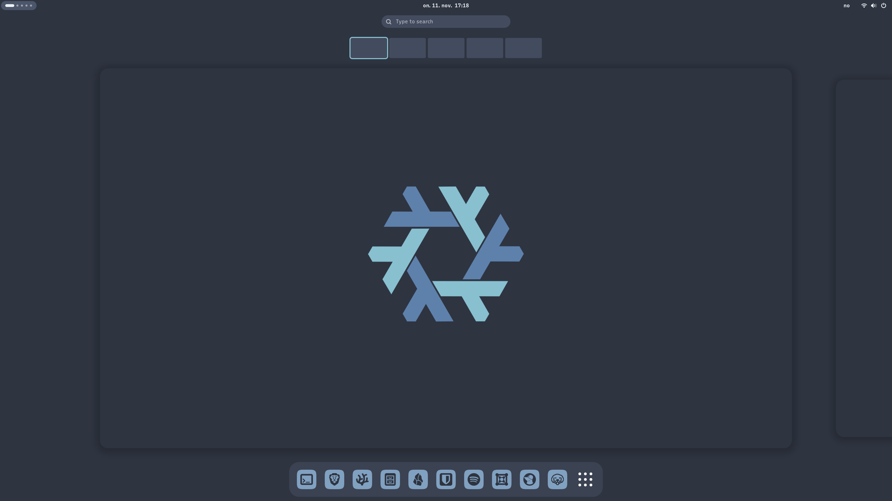

<h1 align="center">nordix</h1>

<p align="center">
  Opinionated NixOS setup for a full GNOME desktop, themed in Nord
</p>

<p align="center">
  
</p>

<p align="center">
  
  &ensp;
  
  &ensp;
  
  &ensp;
  
</p>

<p align="center">
  <a href="#overview">Overview</a> |
  <a href="#installation">Installation</a> |
  <a href="#usage">Usage</a> |
  <a href="#structure">Structure</a> |
  <a href="#development">Development</a>
</p>

## Overview

- NixOS flake: fresh install to finished GNOME desktop.
- [nordix theme](theme/README.md): GNOME Shell, GTK 3/4, icons and login screen. Works without Nix on any GNOME distro via a [release](https://github.com/FjellOverflow/nordix/releases) tarball.

| Machine    | Profiles                               |
| ---------- | -------------------------------------- |
| `gigabyte` | `workstation`, `development`, `gaming` |
| `thinkpad` | `workstation`, `development`           |
| `vm`       | `workstation`                          |

## Installation

Starts from a fresh NixOS install with internet.

> [!IMPORTANT]
> Replace the values in [`variables.nix`](variables.nix) first.

1. Clone

```sh
nix-shell -p git
git clone https://github.com/FjellOverflow/nordix.git ~/.nordix && cd ~/.nordix
```

2. Copy the generated configs

```sh
mkdir machines/<host>
sudo cp /etc/nixos/configuration.nix machines/<host>/default.nix
sudo cp /etc/nixos/hardware-configuration.nix machines/<host>/hardware-configuration.nix
sudo chown $(whoami): machines/<host>/*
```

3. Reduce `machines/<host>/default.nix` to hardware facts and profile imports, like the existing machines

4. Switch

```sh
git add .   # flakes only see tracked files
sudo nixos-rebuild switch --flake ~/.nordix#<host>
```

5. Link `/etc/nixos` to the repository

```sh
sudo rm -rf /etc/nixos
sudo ln -s ~/.nordix /etc/nixos
```

> [!NOTE]
> Don't move `~/.nordix` afterwards.

## Usage

```sh
cd ~/.nordix && git pull
nh os switch
```

## Structure

| Layer      | Path                  | Contains                                |
| ---------- | --------------------- | --------------------------------------- |
| `base`     | `base/common.nix`     | what every machine gets                 |
| `modules`  | `modules/<name>.nix`  | one feature, everything about it        |
| `profiles` | `profiles/<name>.nix` | related modules, plus one-liners        |
| host       | `machines/<host>/`    | hardware facts, profile imports         |
| theme      | `theme/`              | the theme, Nix-free                     |

`modules/theme.nix` owns everything visual.

`theme/` builds without Nix (`./build.sh`: `sh`, `jq`, `python3`) and is tagged separately as `theme-vX.Y.Z`. The flake builds it as `.#theme`.

## Development

[direnv](https://direnv.net/) loads the devShell with all tools.

```sh
nix run .#lint    # statix + deadnix + nixfmt
nix flake check   # evaluate every machine
nix build .#theme # build theme/ in the Nix sandbox
```

Theme development and releases: [theme README](theme/README.md#development).

### CI

| Workflow             | Runs on                   | Does                                                     |
| -------------------- | ------------------------- | -------------------------------------------------------- |
| `nix.yaml`           | every non-Markdown change | `nix run .#lint`, `nix flake check`, `nix build .#theme` |
| `theme.yaml`         | changes under `theme/`    | build, tests, shellcheck, without Nix                    |
| `theme-release.yaml` | `theme-v*` tags           | release tarball and checksum                             |

CI checks evaluation and formatting, not runtime behaviour.
